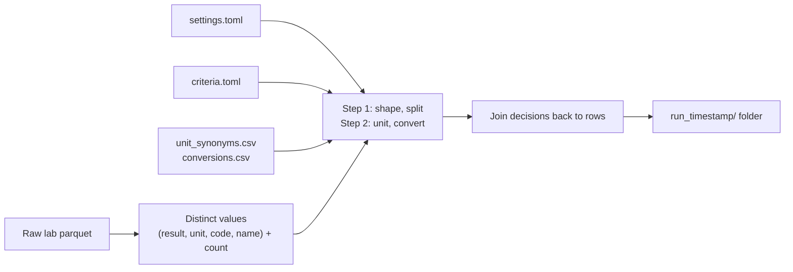

# How `lab_harmonize.py` works

**Summary**: The runner adds 14 columns to every lab row in two steps. It never changes a source
column. It never guesses: an unclear value goes to `review`.

| Step | Rule file | Result |
|---|---|---|
| 1. Split | `criteria.toml` | `RESULT_VAL` becomes a number, a range, or a label with a modifier |
| 2. Harmonize units | `unit_synonyms.csv`, `conversions.csv` | One spelling per unit; registered pairs convert into `_std` columns |

All rules are data files. Code changes are not necessary to add a word, a spelling or a conversion.

| You want to | Edit or read | Section |
|---|---|---|
| Point the runner at your files | `settings.toml` | §1 |
| Add a word, grade, modifier, null-like string or misspelling | `criteria.toml` | §3.7 |
| Unify a unit spelling (`K/ul` = `10^3/uL`) | `unit_synonyms.csv` | §4.1 |
| Convert a test to another unit | `conversions.csv` | §4.2, §4.3 |
| Find the code for a test | `code_dictionary.csv` | §4.5 |
| See what still needs a person | `review/*_review_top.csv`, `units_not_registered.csv` | §5 |

---

## 1. One run



The runner judges each distinct value once, not once per row. A 25-million-row file has a few
hundred thousand distinct values. A file takes seconds.

| `settings.toml` group | Keys | Default |
|---|---|---|
| `[paths]` (edit on your device) | `lab_dir`, `output_dir` | Author's paths |
| `[input]` | `files` (empty list = all files that match `file_glob`) | One small file |
| `[output]` | `write_harmonized_files`, compression | Off |
| `[columns]` | `code`, `result`, `unit`, `name`, `exclude_code_prefixes`, `link`, `exclude_linked` | `MB` excluded, also through `OBS_ID` |

Microbiology is out of scope. The runner excludes a row for one of two reasons:

| Reason | Setting | Example |
|---|---|---|
| The code starts with an excluded prefix | `exclude_code_prefixes = ["MB"]` | `MB` culture codes |
| The row shares its `link` value with a row of the first kind | `link = "OBS_ID"`, `exclude_linked = true` | `No growth` with an empty `CODE_TEST` in an `MB` order |

Before the first file, the runner reads two columns (`link` and `code`) from all selected files.
It collects the `link` values of the prefix rows. An empty `link` or `exclude_linked = false`
turns the second reason off.

Excluded rows stay in the harmonized file at their position. They get `shape = microbiology` and
null in the other 13 new columns. The log counts them per file, by prefix and by link.

---

## 2. What a run produces

Each run writes a new folder in `output_dir`. An empty `output_dir` means the script folder. A run
never overwrites an earlier run.

```
run_<YYYYMMDD_HHMMSS>/
├── lab_harmonize.log            file digests, compiled patterns, counts per file, timings
├── distribution_comparison.csv  one row per file: excluded_rows, excluded_linked_rows,
│                                split / missing / review shares, shape shares,
│                                parse_failures, row_count_match
├── code_dictionary.csv          every code with its names and units (§4.5)
├── units_not_registered.csv     (code, unit) pairs still to decide, over all files (§4.5)
├── conversions_applied.csv      conversions that ran, rows, files (§4.5)
├── harmonized/<input name>      source rows + 14 columns, same name, order and codec as source
├── decisions/<stem>_decisions.csv   every distinct value + 14 decision columns (audit trail)
└── review/<stem>_review_top.csv     most frequent values still in review
          <stem>_near_vocab.csv      single words near a known word: typo report (§3.6)
```

`<stem>` is the input file name up to the first dot. The `decisions/`, `review/` and share figures
cover processed rows only. The harmonized file has all source rows.

### The 14 new columns

| Step | Column | Content |
|---|---|---|
| 1 | `shape` | One of 17 shapes (§3.2), or `microbiology` |
| 1 | `split_action` | `split`, `missing` or `review` (§3.3) |
| 1 | `operator` | `<`, `<=`, `>`, `>=`, `=`, `+` |
| 1 | `number` | Numeric value (float) |
| 1 | `range_low`, `range_high` | Range bounds |
| 1 | `unit` | Recorded unit in the agreed spelling (§4.1) |
| 1 | `value` | `Positive`, `Negative`, `Reactive`, `Non-Reactive`, `Equivocal` |
| 1 | `qualifier` | Modifier or grade: `Weakly`, `Trace`, `Few`, `Adequate`, `Over` |
| 2 | `number_std`, `range_low_std`, `range_high_std` | Converted if registered, else a copy |
| 2 | `unit_std` | Target unit if converted, else `unit` |
| 2 | `conversion_status` | `convert`, `not_registered`, or null (not a numeric shape) |

`number` + `unit` are what the lab reported. `number_std` + `unit_std` are what a project uses.

### Example: before and after

Blank cells are null. `200106` (LDL) has a registered `mmol/L → mg/dL` row. `K/ul` is a synonym of
`10^3/uL`.

| `CODE_TEST` | `RESULT_VAL` | `UNIT` | `shape` | `split_action` | `operator` | `number` | `range_low` | `range_high` | `unit` | `value` | `qualifier` | `number_std` | `unit_std` | `conversion_status` |
|---|---|---|---|---|---|---|---|---|---|---|---|---|---|---|
| 200106 | `3.5` | mmol/L | plain_numeric | split | | 3.5 | | | mmol/L | | | 135.3275 | mg/dL | convert |
| 200106 | `135` | mg/dL | plain_numeric | split | | 135 | | | mg/dL | | | 135 | mg/dL | not_registered |
| 200106 | `0.5-1.5` | mmol/L | numeric_range | split | | | 0.5 | 1.5 | mmol/L | | | | mg/dL | convert |
| 200058 | `< 5` | umol/L | operator_numeric | split | < | 5 | | | umol/L | | | 0.05656 | mg/dL | convert |
| 250657 | `7.2` | K/ul | plain_numeric | split | | 7.2 | | | 10^3/uL | | | 7.2 | 10^3/uL | not_registered |
| 100063 | `Weakly Positive` | | qualifier_numeric | split | | | | | | Positive | Weakly | | | |
| 400091 | `Not Detected.` | | qualifier_detection | split | | | | | | Negative | | | | |
| 150511 | `Trace` | /HPF | severity_grade | split | | | | | /HPF | | Trace | | /HPF | |
| 150501 | `Centrifuged 10 ml. urine` | | mixed_text_numeric | review | | | | | | | | | | |
| L | `None` | | null_literal | missing | | | | | | | | | | |
| 250510 | `*0000` | fL | not_reported_sentinel | missing | | | | | | | | | | |

The range row also converts its bounds: `range_low_std` 19.33, `range_high_std` 58.00.

---

## 3. Step 1: split

### 3.1 Clean the raw string (`[general]`)

| Order | Rule | Key | Example |
|---|---|---|---|
| 1 | Cast to text, trim whitespace | — | `' 5 '` → `5` |
| 2 | No letters, ends in digit / `+` / `%` then full stops: remove the stops | `numeric_trailing_dot` | `3.8.` → `3.8`, `1+.` → `1+` |
| 3 | One word in stray punctuation: remove the punctuation | `word_leading_punct`, `word_trailing_punct` | `!few` → `few`, `Adequate,` → `Adequate` |

Rule 3 skips a value with a digit or a second word. `UNIT` is trimmed; an empty unit becomes null.

### 3.2 Shape

The chain is first-match-wins. The order is the specification.

| # | Shape | Test (criteria key) | Examples |
|---|---|---|---|
| 1 | `missing` | null or empty | `""` |
| 2 | `null_literal` | `[missing] null_literal` | `None`, `N/A`, `NA` |
| 3 | `not_reported_sentinel` | `[missing] not_reported_sentinel` | `*0000`, `*000` |
| 4 | `narrative_text` | `[general] break_pattern`, or longer than `narrative_length` | multi-line comments |
| 5 | `plain_numeric` | a number (`[numeric] core` / `leading_dot`), optional `%` | `5`, `1,234`, `18%`, `.5` |
| 6 | `operator_numeric` | `[operators] tokens` + number | `<5`, `>= 100`, `</=10` |
| 7 | `numeric_range` | number, `range_separator`, number | `0-1`, `2.5 – 3.5` |
| 8 | `ordinal_plus` | digits + `+` | `1+`, `3+` |
| 9 | `verbal_operator_numeric` | `[verbal_operators]` word + number | `Over 20`, `less than 5` |
| 10 | `qualifier_numeric` | optional number, optional modifier, `[qualifier.values]` word, optional gloss | `Positive`, `Dimly Positive`, `Negative(ตรวจไม่พบเชื้อ)` |
| 11 | `qualifier_ordinal` | qualifier word + `N+` | `Positive 3+` |
| 12 | `qualifier_comparison` | qualifier word and `op number`, either order | `Negative < 2`, `< 10.0 Negative` |
| 13 | `mixed_text_numeric` | a standalone number (`[general] standalone_number`), no match above | `Centrifuged 10 ml. urine`, `1:80` |
| 14 | `qualifier_detection` | optional modifier, `[detection.values]` phrase, optional `.` | `Detected`, `Not Detected.` |
| 15 | `severity_grade` | a bare `[severity]` word | `Trace`, `Few`, `Adequate`, `Decreased` |
| 16 | `short_text` | a letter, no standalone number, no match above | `Clear`, `Negative for JAK2 V617F Mutation` |
| 17 | `punctuation_or_junk` | no letter, no digit | `-`, `**` |

- Shape 13 comes before 14 and 15. A value with a free number is a compound result, so a person
  reviews it.
- A standalone number has a non-letter or the string edge on both sides. So `JAK2` is an
  identifier, not a measurement.

### 3.3 Split action

| `split_action` | Shapes | Meaning |
|---|---|---|
| `missing` | 1, 2, 3, 17 | No usable value |
| `split` | 5–12, 14, 15 | Typed columns are filled (§3.4) |
| `review` | 4, 13, 16 | A person must look at it |

Guard: a value that ends in `%` with a recorded unit other than `%` (or null) goes to `review`.

### 3.4 Typed columns

| Column | Shapes | Source |
|---|---|---|
| `operator` | `operator_numeric` | The token, via `[operators.normalize]` (`</=` → `<=`) |
| | `verbal_operator_numeric` | `over/above/greater than` → `>`; `under/below/less than` → `<` |
| | `ordinal_plus`, `qualifier_ordinal` | `+` |
| | `qualifier_comparison` | The token in the string |
| `number` | `plain_numeric`, `operator_numeric`, `verbal_operator_numeric` | The number, without thousands commas and `%` |
| | `ordinal_plus`, `qualifier_ordinal` | Digits before `+` (`3+` → 3) |
| | `qualifier_numeric`, `qualifier_comparison` | First number in the string, if any |
| `range_low`, `range_high` | `numeric_range` | The two bounds |
| `unit` | Numeric shapes, `severity_grade` | Recorded unit, or `%` if the value ends in `%` |
| | Qualitative shapes, `ordinal_plus` | Null |
| `value` | `qualifier_*` | `[qualifier.values]` label; first match wins (`non-reactive` before `reactive`) |
| | `qualifier_detection` | `[detection.values]` label; negated phrases first |
| `qualifier` | `qualifier_numeric`, `qualifier_detection` | `[qualifier.modifier_ranges]`, then `[qualifier.modifiers]` |
| | `severity_grade` | The grade label. A grade never becomes a `value` |
| | `verbal_operator_numeric` | The word as written (`Over`, `Less Than`) |

Other columns stay null. `missing` and `review` rows have all typed columns null.

### 3.5 What the runner does not do

| Not done | Reason | Example |
|---|---|---|
| Map a value whose meaning depends on the test | Same string, different meaning per test | `Yes`/`No` (workflow flags), `Normal`, `non` |
| Resolve admin phrases | The set grows every year; each needs a person | `แพทย์ไม่แจ้ง`, `See Comment`, `DONE` |
| Parse compound sentences | Only one word or modifier + word is safe | `No Paraprotein Detected`, `Positive fine speckled titer 1:80` |
| Interpret grades | `3+` is operator `+`, number 3; no "moderate" label | `3+` |
| Test-specific rules | Open-ended upkeep | See below |

`Decision`: `None` is `missing` for every code. The serum indices (`L`, `H`, `I`) use `None` as a
real grade (13.7M rows, 2015–2023). From 2024 the source stores a blank for the same result. The
runner treats both alike and accepts a missing share of about 8 % per year.

### 3.6 Misspellings: no fuzzy matching

Every rule is an exact regex. A typo (`fewww`, `Nagative`) becomes `short_text` → `review`. That is
about 400 rows in 335 million (2012–2025).

Fuzzy matching was rejected. False matches outnumber true typos about 400 to 1 in rows:

| Fuzzy pair | Edits | Effect |
|---|---|---|
| `DONE` → `none` | 1 | 153,000 admin rows become `missing` |
| `Male` → `many` | 1 | Sex becomes a quantity |
| `Abnormal` → `normal` | 2 | Opposite meaning |

Each run writes `review/<stem>_near_vocab.csv` instead. It lists single-word `review` values within
`[near_miss] max_distance` edits of a `[near_miss] vocabulary` word. The report never changes a
decision. To accept a typo, add it as an explicit alternative, for example `'fe+w+' = 'Few'`.

`Decision` (2026-09-04): the 2012–2025 sweep added about 450 rows of clear typos:

| Word | Spellings added |
|---|---|
| few | 22 (`ferw`, `feqw`, `fewq`, `feww`, …) |
| trace | 17 (`teace`, `tarce`, `trece`, …) |
| others | `moderat`, `adequete`, `decreasd`, `positve`, `nagative`, `equivoca`, `borderli`, `undetect`, `markedly` |

Left out: real words near a known word (`Male`, `mass`, `MAHA`), `Inadequate`, digit-glued forms
(`few1`, `trace3`), words with a stray Thai vowel mark.

### 3.7 Edit `criteria.toml`

| New item | Where | Example |
|---|---|---|
| Qualitative word | `[qualifier.values]`, before any word it overlaps | `'indeterminate' = 'Indeterminate'` |
| Intensity word | `[qualifier.modifiers]`; ranges in `[qualifier.modifier_ranges]` | `faintly`, `faintly - dimly` |
| Grade or quantity word | `[severity]`, with inflections | `'decreased?'` |
| Misspelling | Same line as the word | `'few\|feww'` |
| Null-like string | `null_literal` regex. First confirm no test uses it as a result | `<Blank>` |

1. Edit the file.
2. Run again.
3. Compare `distribution_comparison.csv` with the previous run. `split` goes up, `review` goes
   down, `missing` stays (unless you changed `[missing]`).

Patterns are Rust regex (Polars): `(?i)` case-insensitive, `\p{L}` any letter, `\b` word boundary,
no look-behind. TOML literal strings (`'...'`) need no escapes. In pattern → label tables the first
match wins.

---

## 4. Step 2: harmonize units

### 4.1 `unit_synonyms.csv`

Columns: `unit_as_recorded`, `unit_to_use`, `note`. The `unit` column gets `unit_to_use`. The
decisions file keeps the raw spelling in `unit_recorded`.

| Rule | Example |
|---|---|
| Lookup ignores case and whitespace | `MG / DL` needs no row |
| Any unit named in this file or `conversions.csv` is a known spelling | `mg/dl` snaps to `mg/dL` |
| An unknown spelling stays as it is | — |
| Empty `unit_to_use` = not a unit; the unit becomes null | `๐` (Thai digit) |

Seed examples: `K/ul`, `x 10\S\3/cumm` → `10^3/uL`; `Copies`, `cp/mL` → `copies/mL`; `mg%`,
`mg/dL1` → `mg/dL`; `'c`, `Celsius` → `C`. A new spelling on a multi-unit code shows up in
`units_not_registered.csv`.

### 4.2 `conversions.csv`

One row per converted `(code, unit_source)`. No row = no conversion. A single-unit test needs no
row.

| Column | Meaning |
|---|---|
| `code`, `unit_source` | Key: a `CODE_TEST` and a unit, spelled as `unit_synonyms.csv` spells it |
| `unit_target` | The code's chosen unit |
| `method` | `1` prefix, `4` molar → mass, `5` mass → molar, `9` multiplier, `0` none (§4.3) |
| `factor` | SI prefix part (1/4/5) or full multiplier (9). Never biology: `mmol/L → mg/dL` is always `0.1` |
| `molar_mass` | g/mol, methods 4 and 5 only |
| `test_name`, `note`, `added_by`, `added_on` | Provenance |

The loader checks the file before any data file. It stops the run on: duplicate key, unit not in
agreed spelling, unknown method, missing factor (1/4/5/9), missing molar mass (4/5). The loader does
not check that a factor is correct. The person who adds the row checks one value by hand.

A test under several codes needs one row per code. Glucose has fifteen codes.

To add a conversion:

1. Find the code in `code_dictionary.csv`.
2. Pick method and factor from §4.3.
3. Append one row.
4. Run again.
5. Find the pair in `conversions_applied.csv`.

### 4.3 Choose a method

$x$ = reported number, $f$ = `factor`, $M$ = `molar_mass` (g/mol).

| Method | Use for | Formula | `factor` | `molar_mass` |
|---|---|---|---|---|
| `1` | Same quantity, other prefix: `ng/mL → ng/L`, `g/L → g/dL` | $x \cdot f$ | Scaling ($10^3$ for `ng/mL → ng/L`) | empty |
| `4` | Molar → mass: `mmol/L → mg/dL`, `umol/L → mg/dL` | $x \cdot f \cdot M$ | Prefix part ($0.1$, $10^{-4}$) | required |
| `5` | Mass → molar: `mg/dL → mmol/L`, `ng/mL → nmol/L` | $x \cdot f / M$ | Prefix part ($10$, $10^3$) | required |
| `9` | Published constant, not a prefix or molar mass | $x \cdot f$ | Whole factor | empty |
| `0` | Same unit (prefer `unit_synonyms.csv`) | $x$ | ignored | empty |

$f$ and $M$ are separate columns. The prefix is the same for all analytes, so you copy it from the
table below. You look up only $M$.

| Test | Code | Pair | Method | $f$ | $M$ | Result |
|---|---|---|---|---|---|---|
| Cholesterol | 200047 | `mmol/L → mg/dL` | 4 | 0.1 | 386.65 | $38.67x$ (5.2 → 201) |
| Glucose | 200076 | `mmol/L → mg/dL` | 4 | 0.1 | 180.16 | $18.0x$ |
| Creatinine | 200058 | `umol/L → mg/dL` | 4 | $10^{-4}$ | 113.12 | $0.01131x$ |
| Lactate | 200098 | `mg/dL → mmol/L` | 5 | 10 | 90.08 | $0.111x$ |
| Triglyceride | 200157 | `mmol/L → mg/dL` | 4 | 0.1 | 885.7 (mixture average) | $88.57x$ |
| Phosphate | 200090 | `mmol/L → mg/dL` | 4 | 0.1 | 30.97 (as P, not PO₄) | $3.097x$ |
| Troponin T | 200159 | `ng/mL → ng/L` | 1 | 1000 | — | $1000x$ |
| Urine creatinine | 150660 | `mg/dL → g/dL` | 1 | $10^{-3}$ | — | $0.001x$ |
| Albumin | 200008 | `g/L → g/dL` | 1 | 0.1 | — | $0.1x$ |
| NT-proBNP | 200127 | `pmol/L → pg/mL` | 9 | 8.457 | — | published constant |

Prefix factors ($f$) for pairs in this data:

| Pair | $f$ | Pair | $f$ |
|---|--:|---|--:|
| `mmol/L → mg/dL` | 0.1 | `mg/dL → mmol/L` | 10 |
| `umol/L → mg/dL` | 0.0001 | `umol/L → ug/dL` | 0.1 |
| `mmol/day → g/day` | 0.001 | `mmol/day → mg/day` | 1 |
| `g/L → mg/dL` | 100 | `g/L → g/dL` | 0.1 |
| `mg/dL → g/dL` | 0.001 | `mg/dL → mg/L` | 10 |
| `ug/mL → g/L` | 0.001 | `mg/mL → g/L` | 1 |
| `ng/mL → g/L` | 0.000001 | `ng/mL → nmol/L` | 1000 |
| `ng/mL → ng/L` | 1000 | `pg/mL → ng/dL` | 0.1 |
| `ug/L → mg/L` | 0.001 | `ug/mL → mg/L` | 1 |
| `mg/mL → mg/L` | 1000 | `mg/L → ug/mL` | 1 |
| `ug/mL → ng/mL` | 1000 | `ug/L → ng/mL` | 1 |
| `mmol/L → ug/L` | 1000 (× $M$) | | |

For another pair, use m = $10^{-3}$, u = $10^{-6}$, n = $10^{-9}$, p = $10^{-12}$, dL = 0.1 L,
mL = $10^{-3}$ L. Then check one value by hand.

`Decision`: the direction follows the unit the lab reports today. Lactate moved to `mmol/L` in
2015, so old `mg/dL` rows move forward. Glucose stayed `mg/dL`, so its `mmol/L` rows move back. A
code has one direction only.

### 4.4 The five unit columns

| Column | Converted pair | Other pair |
|---|---|---|
| `number_std`, `range_low_std`, `range_high_std` | Converted value | Copy of the split value |
| `unit_std` | `unit_target` | `unit` |
| `conversion_status` | `convert` | `not_registered` |

The numeric shapes are `plain_numeric`, `operator_numeric`, `numeric_range` and
`verbal_operator_numeric`, with `split_action = split`. Every other row gets a null
`conversion_status`. This is also true when the row has a `number`, for example `0.01 Negative`
or `3+`. The `_std` columns of such a row are a copy of the split values.

`not_registered` is not a warning. It is correct for every single-unit test. The runner does not
round converted numbers: 1.5 ng/mL becomes 0.0000015 g/L.

### 4.5 The three unit reports

Each report covers all input files of the run, sorted by `code`. `files` and `n_files` say in
which files the code (and unit) occurs. `n_rows` counts rows in all files of the run.

| Report | Use | Row |
|---|---|---|
| `code_dictionary.csv` | Find a code ("the code for HDL", "codes in `KUA/L`"); spot a code with two tests (`402053`) | One per code: `test_names`, `units_recorded`, `units_used`, `n_rows` |
| `units_not_registered.csv` | Work queue before a project uses a test. 95 rows in 47 codes (prod run, 2026-10-30) | One per unregistered pair on a multi-unit code, except the code's target unit |
| `conversions_applied.csv` | Confirm a conversion ran. It does not judge the factor | One per applied pair: rows touched, files |

`Decision` (2026-10-30): the runner decides "multi-unit code" over the whole run, not per file.
The data is longitudinal. A code that changes unit at a year boundary has one unit in each file.
Over the whole run it has two, so it appears in `units_not_registered.csv`. A blank unit does not
count as a second unit.

### 4.6 Registry origin

The seed is an earlier hand-built table (181 codes; method scheme and molar masses kept) plus three
rows from `laboratory.xlsx`. The `added_by` column names the source of each row. Six seed errors
were corrected; each row says so in `note`:

| Test | Before | After |
|---|---|---|
| Triglyceride | $M$ 176.12 (× 17.6) | $M$ 885.7 (× 88.57) |
| Phosphate | $M$ 94.97 (× 9.5) | $M$ 30.97 (× 3.097) |
| Lithium `mmol/L → ug/L` | $f$ 0.001 | $f$ 1000 |
| Transferrin `ng/mL → g/L` | $f$ 1e6 | $f$ 1e-6 |
| Urine creatinine `mg/dL → g/dL` | method 4 | method 1 |
| Methanol | `mg%` × 10 | `mg%` = `mg/dL` |

Pairs with no fixed constant are not in the file (copies vs IU/mL, `KUA/L` vs `PAU/L`, mercury
`ug/day` vs `ug/L`). They stay unconverted and appear in `units_not_registered.csv` on every run.

---

## 5. Check a run

1. `lab_harmonize.log`: no `FAILED`. Each file has `row count check: source N = harmonized N`.
   Each file has a `rows:` line with the excluded rows by prefix and by link.
2. `distribution_comparison.csv`: `row_count_match` is `true` and `parse_failures` is 0 for every
   file. A parse failure is a `split` row with nothing extracted.
3. `review/<stem>_review_top.csv`: each frequent value is a rule to add (§3.7) or a known exclusion
   (§3.5).
4. `review/<stem>_near_vocab.csv`: typos worth an explicit alternative (§3.6).
5. `units_not_registered.csv`: pairs to decide before a project uses the test (§4.5).
6. `conversions_applied.csv`: confirm that a new row ran.

---

## 6. Glossary

| Term | Meaning |
|---|---|
| shape | What a result string looks like: 17 labels (§3.2), or `microbiology` |
| `split` / `missing` / `review` | The three outcomes of step 1 (§3.3) |
| typed columns | `operator`, `number`, `range_low`, `range_high`, `unit`, `value`, `qualifier` |
| `value` vs `qualifier` | `value` is the result (`Positive`). `qualifier` grades or modifies it (`Weakly`, `Trace`) |
| `_std` columns | Step 2 output: converted if registered, else a copy |
| `not_registered` | No `conversions.csv` row for the pair; value unchanged |
| distinct table | `(result, unit, code, name)` + count; written to `decisions/` |
| `<stem>` | Input file name up to the first dot |
| method, `factor`, `molar_mass` | How a conversion is computed (§4.3) |
