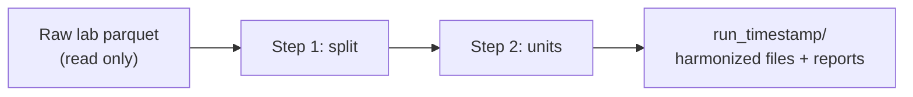

# lab_harmonize

`lab_harmonize.py` turns raw laboratory results into columns that a project can use. One run does
two steps:

| Step | What the runner does | Rule file |
|---|---|---|
| 1. Split | It splits the free-text result (`RESULT_VAL`) into a number with its operator and unit, a range, or a label with its modifier. It marks an unclear value `review` and never guesses. | `criteria.toml` |
| 2. Harmonize units | It writes each unit in one spelling. It converts the numbers of each registered `(code, unit)` pair into `_std` columns. It copies all other numbers unchanged and labels them `not_registered`. | `unit_synonyms.csv`, `conversions.csv` |



The runner never changes a source file. It excludes microbiology rows (code prefix `MB`, and rows
that share their `OBS_ID` with an `MB` row). `HOW_IT_WORKS.md` explains every rule and how to add
one.

## Get the code

You need read access to the `CEB-Data-Science-Clinical-Informatics` organization on GitHub.

To get the code the first time:

1. Open a terminal in the folder where you keep projects.
2. Run `git clone https://github.com/CEB-Data-Science-Clinical-Informatics/Lab_Harmonization.git`.
3. Run `cd Lab_Harmonization`.

With an SSH key, use `git@github.com:CEB-Data-Science-Clinical-Informatics/Lab_Harmonization.git`.
Without Git, select **Code → Download ZIP** on the GitHub page. A ZIP copy cannot get updates.

To get updates, run these commands in the `Lab_Harmonization` folder:

```bash
git stash          # put your local edits (settings.toml paths, new rules) aside
git pull           # get the new version
git stash pop      # put your edits back on top
```

If `git stash pop` reports a conflict:

1. Open the file that Git names.
2. Keep your lines and the new lines.
3. Delete the `<<<<<<<`, `=======` and `>>>>>>>` markers.
4. Run `git stash drop`.

Git ignores the run outputs in `output/`, so a pull never changes them.

To share a rule that you added (a word in `criteria.toml`, a row in `conversions.csv`), open a pull
request. Then every user gets the rule with the next pull.

## Quick start

1. Install Python 3.9 or newer.
2. Run `pip install -r requirements.txt` (polars, pyarrow, and tomli below Python 3.11).
3. Open `settings.toml`. In the block **EDIT THESE ON YOUR DEVICE**, set `lab_dir` (the parquet
   folder) and `output_dir` (the folder for runs).
4. Run `python lab_harmonize.py`. The script takes no arguments. You can also double-click it or
   use "Run file" in your editor.
5. Open `output/run_<timestamp>/lab_harmonize.log` and the `review/` folder.

The shipped settings process one small file and write no harmonized parquet. This first run takes
seconds. For a full run, set `files = []` and `write_harmonized_files = true` in `settings.toml`.
A full run of 16 files takes about 3 to 5 minutes. The output is about the size of the input.

## What a run writes

Each run writes one new folder, `run_<timestamp>/`, in `output_dir`:

```
run_<timestamp>/
├── lab_harmonize.log             what ran, with counts per file and rule-file digests
├── distribution_comparison.csv   split / missing / review share and excluded rows per file
├── code_dictionary.csv           every code with its names and units: look up a test here
├── units_not_registered.csv      code–unit combinations to decide before a project uses the test
├── conversions_applied.csv       the conversions that ran, and where
├── harmonized/                   one parquet per input file: same name, rows and compression + 14 new columns
├── decisions/                    every distinct value and its decision (audit trail)
└── review/                       most frequent values in review; near-miss (typo) report
```

The 14 new columns:

| Step | Columns |
|---|---|
| 1 | `shape`, `split_action`, `operator`, `number`, `range_low`, `range_high`, `unit`, `value`, `qualifier` |
| 2 | `number_std`, `range_low_std`, `range_high_std`, `unit_std`, `conversion_status` |

`number` and `unit` are what the lab reported. A project uses `number_std` and `unit_std`.

## Files you edit

| File | Controls |
|---|---|
| `settings.toml` | Where to read, what to write, column names. You edit the `[paths]` block. |
| `criteria.toml` | Step 1: the shape rules (regular expressions and label maps). Add words and misspellings here. |
| `unit_synonyms.csv` | Step 2: unit spellings with the same meaning, and the spelling to keep (`K/ul` = `x 10\S\3/cumm` → `10^3/uL`). |
| `conversions.csv` | Step 2: registered unit conversions per `(code, unit)`. Add a row when a project needs a test converted. |
| `CHANGELOG.md` | Add a dated line when you change one of the files above. |

## Typical tasks

| Task | Steps |
|---|---|
| A frequent value is still `review` | Find it in `review/<stem>_review_top.csv`. Add the word to `criteria.toml` (`HOW_IT_WORKS.md` §3.7). Run again. Compare `distribution_comparison.csv`. |
| A test has two units and you need one | Find the code in `code_dictionary.csv`. Check `units_not_registered.csv`. Add a row to `conversions.csv` with a method from §4.3. Run again. Find the pair in `conversions_applied.csv`. |
| A test has one unit | Do nothing. The runner copies its values into the `_std` columns. |
| A new unit spelling appears | Add one row to `unit_synonyms.csv`. Differences in case and spaces need no row. |

## Results of the 2026-10-30 runs

Both runs processed all 16 annual files with the same rule files. The share ranges are per file.

| | dev | prod |
|---|---|---|
| Extract | `20251231_fu_vte_nc` | `20260630_fu_nc` |
| Period | 2011 to January 2026 | 2011 to July 2026 |
| Rows | 311,305,676 | 325,179,480 |
| Excluded microbiology rows (by `MB` code + by `OBS_ID`) | 3,943,510 + 225,550 | 4,173,686 + 241,809 |
| `split` per file | 85.3–95.6 % | 85.4–95.6 % |
| `missing` per file | 0.1–9.1 % | 0.1–9.1 % |
| `review` per file | 2.9–4.9 % | 2.9–4.9 % |
| Unregistered code–unit combinations | 91 in 45 codes | 95 in 47 codes |
| Parse failures, row-count mismatches | 0, 0 | 0, 0 |

`conversions.csv` registers 94 conversions. The unregistered combinations have no fixed factor,
for example viral loads in copies and in IU, or kit-specific antibody units. Clinicians decide
them. The runner is fast because it applies the rules to distinct values, not to rows.

## Notes

- Paths in `settings.toml` can use forward slashes and `~` on Windows, macOS and Linux.
- If a source file already has a column with one of the 14 new names, list the columns that you
  need in `keep_columns`.
- The log records the SHA-256 of every rule file. You can trace each set of numbers to the rule
  set that made it.
